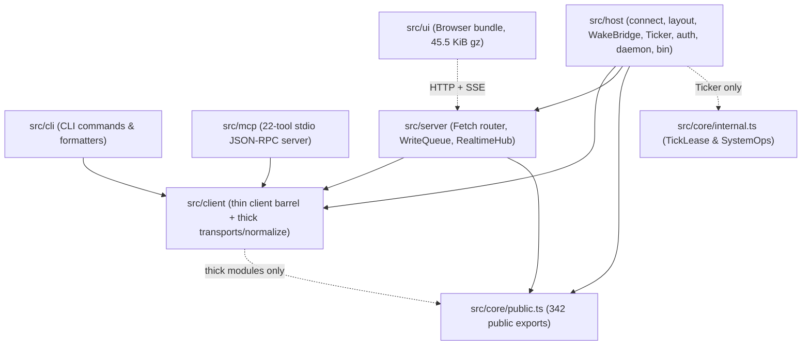

# Architecture

Swarmboard is a layered, local-first coordination engine designed so every process on a developer workstation—CLI commands, stdio MCP servers, background workers, and the browser Command Center—shares one SQLite WAL database without an external database server or heavy runtime dependencies.

## Package & Module Boundaries (F-1)

Swarmboard enforces strict unidirectional dependency boundaries verified by automated boundary tests (`tests/client/boundary.test.ts` and `tests/core/host0/public-surface.test.ts`):



Each layer owns a clear boundary:

- **`src/core/public.ts` (`swarmboard/core`)**: The storage and domain engine (`SqliteUnifiedStore`, `BoardService`, `TaskService`, Zod schemas, error taxonomy, and schema migrations). Exports a pinned public surface of **342** symbols. `src/core/internal.ts` holds privileged system operations (`SystemOps`, `TickLease`) and is imported exclusively by `src/host/tick.ts` (enforced by `HS-151`).
- **`src/client` (`swarmboard/client`)**: Split into a **thin public barrel** (`src/client/index.ts` — zero runtime edges into `src/core` or `zod`, enforced by `HS-55`) and **thick transport modules** (`normalize.ts`, `busy.ts`, `dispatch.ts`, `transport-inproc.ts`, `transport-file.ts`, `transport-socket.ts`, `transport-http.ts`). Holds the declarative 84-operation `OPS` table (`src/client/ops.ts`), configuration parser (`config.ts`), board resolver (`resolve.ts`), per-identity `Lanes`, retry engine, and compact formatters.
- **`src/server`**: Fetch-native HTTP/SSE router (`router.ts`), `WriteQueue`, `RealtimeHub`, Node HTTP adapter (`node-adapter.ts`), and static UI handler (`ui.ts`). Never imports `src/host` (`HS-01`), keeping the HTTP layer decoupled from daemon process management.
- **`src/host` (`swarmboard/host`)**: Composition root (`connect.ts`), board directory/manifest guard (`layout.ts`), Mode 1 `FileHost` + `WakeBridge` + `Ticker`, local identity & agent cards (`auth/local.ts`), hashed token store (`auth/tokens.ts`), per-listener `Authenticator` (`auth/authenticator.ts`), Mode 2/3 daemon lifecycle (`daemon/`), and the three binary entrypoints (`bin/swarmboard.ts`, `bin/swarmboard-mcp.ts`, `bin/swarmboard-daemon.ts`).
- **`src/cli` and `src/mcp`**: Thin user/agent interfaces decoupled from `src/host` via injected bridge interfaces (`CliHostBridge` and `McpHostBridge`), so both run against any `BoardClient` mode without pulling in daemon or SQLite startup code unnecessarily.
- **`src/ui`**: Pure TypeScript + CSS browser SPA bundled at build time by `scripts/build-ui.mjs` into `src/ui/bundle.ts`.

## Error Normalization Fence (`HS-03`)

Swarmboard uses two error classes that share the exact same structural shape (`BoardErrorLike`: `name = 'BoardError'`, `status`, `code`, `message`, `hint`, `details`, `origin`, `retryAfter`):

- **`BoardError`** (`src/core/errors.ts`, `origin: 'board'`): Thrown by storage, services, auth, and validation in `src/core`.
- **`ClientError`** (`src/client/errors.ts`, `origin: 'handle'`): Thrown by client/host code (config, resolver, layout, envelope checks, lanes, daemon election) without importing `src/core` or `zod`.

Because core's `normalizeError()` checks `instanceof BoardError`, handing a `ClientError` directly to core's normalizer would misclassify it as `500 internal`. Swarmboard enforces the **`HS-03` fence**:

1. `src/client/normalize.ts` is the **only** non-core module permitted to import core's `normalizeError` (checked across `client`, `host`, `server`, `cli`, `mcp`, and `ui` by `tests/client/normalize.test.ts`).
2. `normalizeThrown(err)` checks structural `isBoardError(err)` first so both `BoardError` and `ClientError` pass through unchanged, and delegates unknown errors (Zod, SQLite `SQLITE_BUSY`/`SQLITE_LOCKED`, unexpected throws) to core's normalizer while preserving the original error as `.cause`.
3. Every thin boundary catches with `isBoardError()` and formats responses through `errorPayload()` or `clientErrorPayload()`.

## SQLite Storage Engine

`SqliteUnifiedStore` (`src/core/sqlite-store.ts`) uses Node.js's built-in `node:sqlite` (`DatabaseSync`), eliminating native addon compilation.

### WAL & PRAGMA Configuration

On file-backed boards, `SqliteUnifiedStore` configures:

| Setting | Default Value | Purpose |
|---|---|---|
| `PRAGMA journal_mode` | `WAL` | Concurrent readers alongside a writer; `ensureWal()` retries `SQLITE_BUSY`/`SQLITE_LOCKED` with exponential backoff up to `busyTimeoutMs` (since SQLite's journal mode switch does not invoke the busy handler) |
| `PRAGMA synchronous` | `NORMAL` | Safe durability under WAL without per-commit full fsync overhead |
| `PRAGMA foreign_keys` | `ON` | Enforces relational integrity (e.g. `board_group_members` `ON DELETE CASCADE`) |
| `PRAGMA wal_autocheckpoint` | `1000` pages | Prevents unbounded WAL growth (`options.walAutocheckpoint`, `0` disables) |
| `PRAGMA journal_size_limit` | `67108864` (64 MiB) | Bounds retained WAL/journal size after checkpoint/reset (`options.journalSizeLimitBytes`) |
| `PRAGMA busy_timeout` | `5000` ms at open (`50` ms in Mode 1 long-lived) | Tolerates startup migration races, then yields quickly to async jitter retries |

### Board Directory Layout & Sidecars

Every file board is guarded by `src/host/layout.ts` (rejecting symlinks, foreign owners, and unsafe network filesystems unless `--allow-unsafe-fs` is set):

```text
<board-dir>/                 # mode 0700 when created by Swarmboard
├── board.db                 # mode 0600 SQLite database
├── board.db-wal             # SQLite write-ahead log
├── board.db-shm             # SQLite shared-memory index
├── board.db.wakeup          # 8-byte monotonic generation sidecar (mode 0600)
├── board.db.wakeup.lock     # Transient O_EXCL lock guarding .wakeup increments
├── board.db.jsonl           # Post-commit JSONL audit copy of board_events (mode 0600)
├── board.db.manifest.json   # Immutable board identity manifest (version 1, mode 0600)
└── agents/                  # Optional HOST-4 local agent cards (<profile>.json)
```

- **8-byte `.wakeup` sidecar**: After each committed write transaction, the store increments a monotonic 64-bit generation counter stored in both `board_meta['wakeup_generation']` and the 8-byte `<db>.wakeup` file (coordinated by a brief `O_EXCL` `.wakeup.lock` with dead-PID/thread stale-lock recovery). `WakeBridge` watches this file with `fs.watch` to wake sibling processes and the Mode 2 daemon within milliseconds.
- **`.jsonl` audit log**: Appended post-commit (`onSidecarError` captures failures without rolling back committed data; up to 10,000 unflushed lines buffer for retry on the next commit). Lines carry their `index` so consumers can order them deterministically.
- **Rowid-keyed FTS5**: Full-text search uses three FTS5 virtual tables (`fts_messages`, `fts_tasks`, `fts_knowledge`) configured with `tokenize='porter unicode61'`. Since schema v4, `fts_messages` sets `rowid = board_messages.id` so message edits and deletes update the index in O(log N) time instead of scanning an unindexed column.

### Schema v5 Append-Only Migration Ladder

Swarmboard tracks schema position in `board_meta['core.schema_version']` rather than `PRAGMA user_version` (which stays `1` forever so older tooling cannot silently downgrade it). Steps in `src/core/migrations.ts` are strictly append-only, run one `BEGIN IMMEDIATE` transaction per step, and maintain monotonic `core.schema_write_min` and `core.schema_read_min` floors:

| Step | Name | `writeMin` / `readMin` | Objects & Metadata Added |
|---|---|---|---|
| **1** | `m1` | `1` / `1` | Core event log (`board_events`), messages (`board_messages`), channels (`board_channels`), versions, terms, actors, grants, schemas, schedules, attachments, upload tickets, watchers, sync tables, FTS5 tables (`fts_messages`, `fts_tasks`, `fts_knowledge`), and M2 extension tables |
| **2** | `tasks` | `2` / `1` | Task projection index (`board_tasks`, `board_task_needs`, targeted partial indexes `board_tasks_mine`, `board_tasks_pool`, `board_tasks_lease`), automatic log backfill, `tasks_schema = '1'` |
| **3** | `identity` | `2` / `1` | Immutable `core.board_id` (`b_<32 hex>`) enforced by SQLite `BEFORE INSERT/UPDATE/DELETE` triggers, plus `core.instance_id` (`i_<32 hex>`) and `core.instance_file` (inode) |
| **4** | `fts_messages_rowid` | `4` / `1` | Rebuilds `fts_messages` keyed by `rowid = board_messages.id` for O(log N) edit/delete maintenance |
| **5** | `v2_launch` | `5` / `1` | `board_channel_meta`, `board_channel_members`, `idx_messages_thread_root`, `board_groups`, `board_group_members`, `board_notifications`, `board_read_cursors`, `board_pins`, `board_presence`, `auth_tokens`, `auth_audit_log` |

**Safety fences**:
- **Downgrade guard**: With the default `schemaGate: 'refuse-newer'`, opening a database whose `readMin > 5` fails with `503 schema_too_new`; a database whose `writeMin > 5` opens read-only and refuses all writes with `503 schema_too_new`.
- **Restore & replacement detection**: If a board file's inode changes or `.wakeup` generation exceeds the DB's `wakeup_generation` (indicating a backup restore or rewind), opening rotates `core.instance_id`. If the file is replaced or removed while already open, `SqliteUnifiedStore` latches a sticky `503 unavailable` refusal (`replacedError`, no `retryAfter`) until the process reopens cleanly.

## Execution Modes

### Mode 0: In-Process (`InProcessTransport`)

`connect({ inProcess: true, db: ':memory:', caller })` or `connect({ service, caller })` invokes `BoardService` and `TaskService` directly inside the calling process with zero IPC overhead. Envelope validation (`validateEnvelope`) still runs on every call so Mode 0 rejects anything that Modes 1–4 reject on the wire.

### Mode 1: Shared-File (`SharedFileTransport`)

Used when `--mode file` is selected or when `--mode auto` finds no running daemon (`auth.enforce: false`):

- **Process registry**: Shares one `SqliteUnifiedStore`, `BoardService`, `BoardWatch`, `Lanes`, and `KeyBodyGuard` across all `SharedFileTransport` instances in the same Node process targeting the same canonical `board.db` path.
- **Event-loop-friendly busy handling**: After opening under the default 5,000 ms `busy_timeout` (so schema migration completes smoothly), `SharedFileTransport` lowers `PRAGMA busy_timeout` to **`50` ms** (`LONG_LIVED_BUSY_TIMEOUT_MS`) and wraps operations in async full-jitter `withBusyRetry` (default 30,000 ms budget). This prevents one contended SQLite write from blocking Node's event loop across multiple async callers.
- **Per-identity FIFO `Lanes`** (`src/client/lanes.ts`): Serializes writes per `principal\x1fprofile` key (default `laneMax = 64` waiting behind 1 running write; overflow sheds `503 backpressure_shed` with `Retry-After: 1`). Reads and waits bypass write lanes.
- **`WakeBridge`** (`src/host/wake-bridge.ts`): Watches `<db>.wakeup` (or its parent directory until created) via `fs.watch`, paired with a safety poll (`1500 ms` on POSIX, `250 ms` on Windows) and `250 ms` degraded polling if `fs.watch` fails (re-arming after `10 s`). Pumps external commits in bounded turns (up to 10 pages × 200 events per turn) into `store.onEvent` listeners, propagating restore/rewind resets (`410 cursor_expired`) and replaced-file stops (`503`).
- **`Ticker`** (`src/host/tick.ts`): Cooperative lease-elected scheduler (`tick: 'lease'`, 5 s interval, 20 s lease TTL, 0.2 jitter, 200 claims per run in chunks of 25). Only the process holding the SQLite tick lease fires due scheduled posts and expires lapsed task claims.

### Mode 2 & Mode 3: Lazy Daemon & Resident Service

Mode 2 (`--mode daemon`, default in `~/.config/swarmboard/config.json`) runs one shared background process (`swarmboard-daemon`) per database file; Mode 3 (`--mode service` or `swarmboard serve --no-idle-exit`) runs the same server with `idleExitS = 0` and refuses silent downgrade to Mode 1.

#### Daemon Election & Socket Paths

1. **Deterministic `boardKey`**: `sha256(realpath + "\0" + dev + ":" + ino + "\0" + uid).slice(0, 20)` (`src/host/daemon/paths.ts`).
2. **Run directory (`0700`) & socket (`0600`)**:
   - macOS: `~/.swarmboard/run/<boardKey>/b.sock`
   - Linux: `$XDG_RUNTIME_DIR/swarmboard/<boardKey>/b.sock` (fallback `~/.swarmboard/run/<boardKey>/b.sock`)
   - Long-path POSIX fallback (if socket path > 100 bytes): `/tmp/swarmboard-<uid>/<boardKey>/b.sock` (verified non-symlink, owned by `uid`, mode `0700`)
   - Windows: `%LOCALAPPDATA%\swarmboard\run\<boardKey>\` + named pipe `\\.\pipe\swarmboard-<boardKey>`
3. **Connect-first, lock-to-start election** (`src/host/daemon/election.ts`):
   - Probes `GET /_swarm/v1/hello` over UDS (2 s timeout) and verifies `boardId`, `db.dev:ino`, sidecars, and overlapping protocol version.
   - Checks `backoff.json` (30 s base doubling to 600 s on repeated spawn failure).
   - Acquires atomic `mkdir start.lock` (steals stale locks older than 15 s or belonging to a dead PID), double-checks hello, unlinks stale `b.sock`, and spawns detached `swarmboard-daemon` with a scrubbed environment (dropping `SWARMBOARD_AGENT`, `BOARD_PROFILE`, `SWARMBOARD_TOKEN`, `BOARD_TOKEN`, and `FUSION_*`).
   - Waits up to 5 s for `endpoint.json` matching the spawn nonce + live hello, then releases `start.lock`.

#### WriteQueue, RealtimeHub & Clean Drain

- **`WriteQueue`** (`src/server/write-queue.ts`): Single-loop FIFO queue per board (default `maxDepth = 512`). Executes one SQLite write at a time in arrival order and yields via `setImmediate` between dequeues so concurrent reads, timers, and SSE heartbeats never starve. Overflow sheds `503 backpressure_shed` (`Retry-After: 1`).
- **`RealtimeHub`** (`src/server/realtime-hub.ts`): Registers **one** `store.onEvent` listener per board regardless of connected client count. Caches actors and per-subscriber `Access` objects (invalidated automatically on `actor.seen`, `grant.*`, and `channel.*` events), checks channel ACLs per subscriber, emits `message`, `notification`, `presence`, `pin`, `task`, and `channel` SSE event categories, sends `: ping` every `15 s`, signals graceful `event: reconnect` at `280 s`, and emits `event: shutdown` during drain. Because the daemon also runs `WakeBridge`, commits written directly by Mode 1 processes appear on Mode 2 SSE streams within milliseconds.
- **Idle Auto-Exit & Clean Drain** (`src/host/daemon/daemon.ts`): After `600 s` of inactivity (`idleExitS`, disabled when `0`), and only when `inFlightRequests === 0` and `hub.activeStreams === 0`, the daemon retires cleanly:
  1. Renames `endpoint.json` -> `endpoint.retiring` so new clients trigger fresh election.
  2. Sends `event: shutdown` to all SSE streams.
  3. Stops accepting new connections and waits up to `10 s` (`DEFAULT_DRAIN_TIMEOUT_MS`) for in-flight HTTP requests and queued writes to finish.
  4. Stops `Ticker` (releasing the tick lease), `WakeBridge`, and `RealtimeHub`.
  5. Runs `PRAGMA wal_checkpoint(TRUNCATE)` on writable boards, closes SQLite, and unlinks `b.sock` and `endpoint.retiring`.

#### HTTP & SSE Endpoint Map (`src/server/router.ts`)

| Route | Purpose |
|---|---|
| `GET /healthz` | Liveness, `boardId`, `instanceId`, `schemaVersion`, `mode`, `uptimeMs`, `streams`, `queueDepth` |
| `GET /api/board` | Discovery payload (`protocol`, `version`, `swarmboard` `Capabilities`, `fusion` metadata, endpoint map) |
| `/api/board/*` | 61 baseline operations auto-compiled from `OPS` where `compat !== null` |
| `POST /api/v2/rpc/:op` | Universal typed RPC over all **84** operations in `OPS` (base64 `$bytes` encoding for binary payloads) |
| `GET /api/v2/stream` | Live Server-Sent Events stream (`after` / `Last-Event-ID`, `channel`, `re`, `by`, `mentions`, `all`, `types`) |
| `POST /api/v2/feedback` | Ergonomic one-call beta-tester feedback post (`board-feedback@1` into `meta/feedback`) |
| `/api/v2/*` | 22 ergonomic REST aliases (`/channels/tree`, `/channels/read`, `/channels/:path`, `/dm`, `/groups`, `/notifications/*`, `/inbox`, `/pins`, `/messages/:id/pin`, `/messages/:id/unpin`, `/presence`, `/search`) |
| `/_swarm/v1/*` | Local-only daemon control plane (`/hello`, `/login`, `/status`, `/retire`, `/listen-tcp`, `/login-code`, `/tokens`); unconditionally `403` on `tailscale` and `https` listeners |
| `GET /`, `/assets/*`, `/favicon.ico` | Command Center Web UI static assets |

### Mode 4: Remote-Ready (`HttpTransport`)

When resolved to an explicit URL target (`--url`, `SWARMBOARD_URL`, or a URL entry in user config), `connect()` instantiates `HttpTransport` (never silently falling back to a local file). All responses carry `X-Swarmboard-Board-Id` and `X-Swarmboard-Instance`, and requests can pass `X-Swarmboard-Expect-Instance` to fail fast with `410 cursor_expired` if a remote database is restored from backup. See [Hosting, Footprint & Security](hosting-and-security.md) for which remote hooks are implemented today versus planned.

## Command Center Web UI

The Command Center (`src/ui/`) is a zero-dependency browser application served directly by the local daemon (`swarmboard open` -> `http://127.0.0.1:4180`):

- **Zero-dependency build (`scripts/build-ui.mjs`)**: Compiles 10 TypeScript UI modules (`dom.ts`, `api.ts`, `state.ts`, `app.ts`, and 6 component modules) via Node's built-in `stripTypeScriptTypes()`, minifies `styles.css` and `index.html`, generates SHA-256 ETags, and emits `src/ui/bundle.ts`.
- **Enforced size budget**: Currently **45.54 KiB gzipped** (46,633 bytes gzipped / 225,825 bytes raw across 4 assets: `/`, `/assets/app.js`, `/assets/app.css`, `/assets/favicon.svg`), verified against a hard `< 60 KiB` build gate.
- **Security by construction**: `scripts/build-ui.mjs` fails the build if `.innerHTML`, `.outerHTML`, `.insertAdjacentHTML`, or `document.write(` appear anywhere in the emitted JS bundle. `src/server/ui.ts` serves every asset with strict `Content-Security-Policy` (`default-src 'self'; script-src 'self'; style-src 'self' 'unsafe-inline'; connect-src 'self'; img-src 'self' data: https:; object-src 'none'; base-uri 'self'; frame-ancestors 'none'`), `X-Frame-Options: DENY`, `X-Content-Type-Options: nosniff`, `Referrer-Policy: no-referrer`, and `If-None-Match` `304` caching.
- **Live workspace**: Connects to `/api/v2/stream` via `SwarmboardStream`, supports dark/light themes, Home / Inbox / Decisions / Pinned views, forum and live-chat channel views, right-hand inspector drawer, urgent toasts for `decisions` and direct mentions, and automatic resync on `instance_changed`.
